# Hate Speech Detection in Roman Urdu with LLMs

**Parameter-efficient fine-tuning vs. prompt tuning vs. prompt engineering for a low-resource language**

Code for my M.S. Data Science thesis at the Information Technology University (ITU), Lahore. Roman Urdu (Urdu written in Latin script) is widely used on social media but has few NLP resources. This project compares three ways of adapting large language models to classify Roman Urdu comments as hate speech or not:

1. **QLoRA fine-tuning** of six open models: Llama 3 8B, Mistral 7B, Falcon 7B, Gemma 2B, DeepSeek-R1-Distill-Qwen 7B and multilingual BERT.
2. **Prompt tuning** (mixed, prefix and cloze prompts) of multilingual BERT in few-shot settings with OpenPrompt.
3. **Prompt engineering** of GPT-3.5 on Azure OpenAI, comparing zero-shot and few-shot prompting.

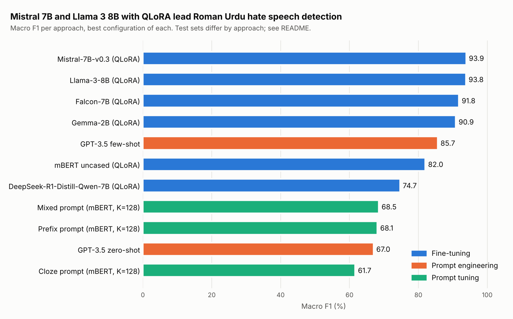

## Key findings

- **QLoRA fine-tuning gives the best results.** Mistral 7B v0.3 (93.9% macro F1, 96.4% accuracy) and Llama 3 8B (93.8% macro F1) lead, while training only small LoRA adapters on a 4-bit quantised model.
- **Small models stay competitive.** Gemma 2B reaches 90.9% macro F1 in about a quarter of the training time of the 7–8B models.
- **Few-shot prompting is a strong no-training option.** Adding curated examples to the GPT-3.5 prompt raised macro F1 from 67.0% (zero-shot) to 85.7%.
- **Prompt tuning with very few labels is limited.** With 32–128 examples per class, mBERT prompt tuning reaches 62–69% macro F1, improving steadily as K grows.
- **A reasoning-distilled model underperformed.** DeepSeek-R1-Distill-Qwen 7B scored 74.7% macro F1, the lowest of the fine-tuned 7B models.

## Methods

### 1. QLoRA fine-tuning

Each model is loaded in 4-bit NF4 precision and frozen. Small low-rank adapter matrices (LoRA, r=16) are trained on top, so only a tiny fraction of the weights change. A sequence-classification head predicts toxic / non-toxic, and a class-weighted loss handles the 82/18 class imbalance.

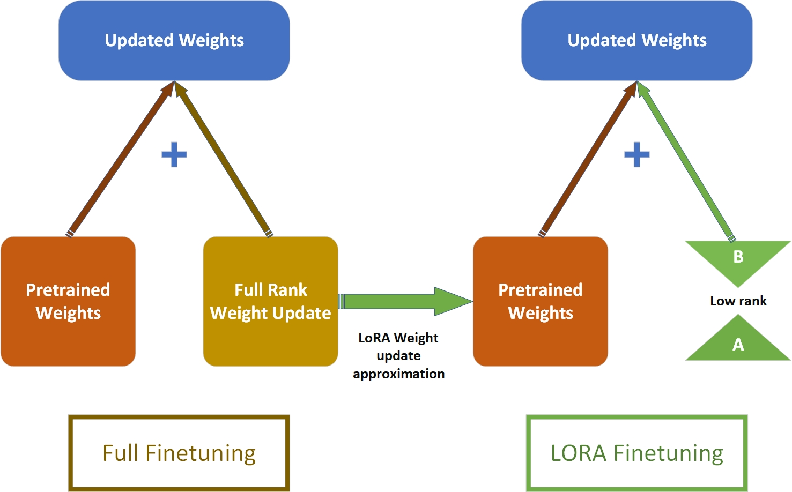

### 2. Prompt tuning (OpenPrompt)

The comment is wrapped in a Roman Urdu template with a `[MASK]` slot. BERT's masked-language-model head predicts a word for the mask, and a **verbalizer** maps label words to classes (e.g. *muhabbat, pyaar, acha* → not toxic; *nafrat, ghussa, gaali* → toxic). The **mixed prompt** adds trainable soft tokens; the **cloze** and **prefix** prompts use fixed hand-written templates.

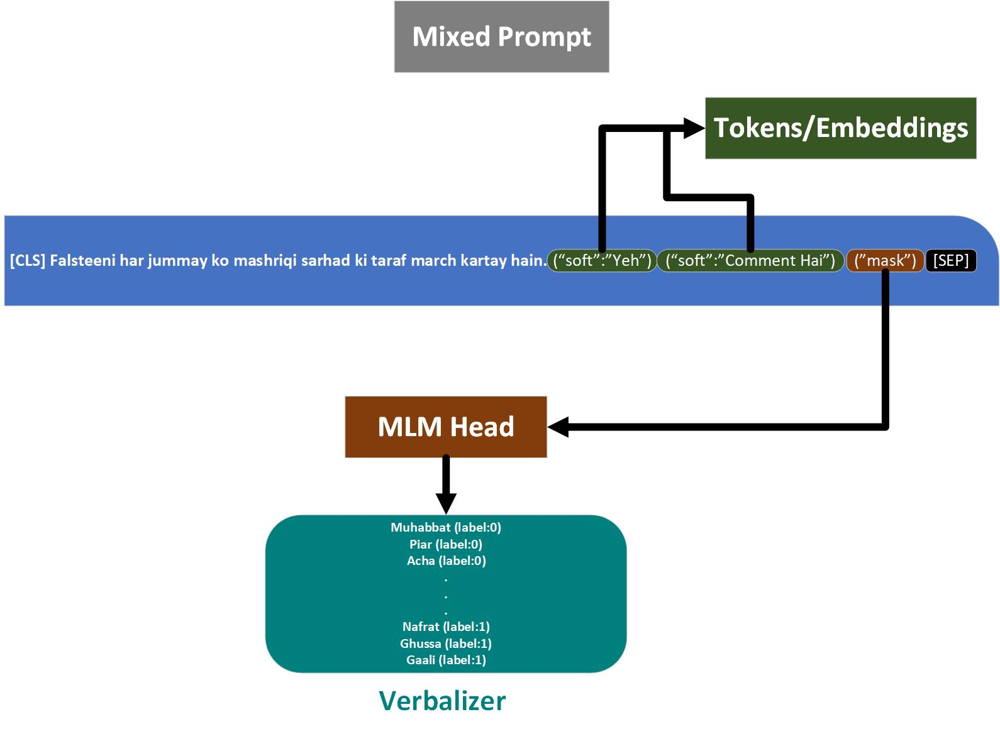

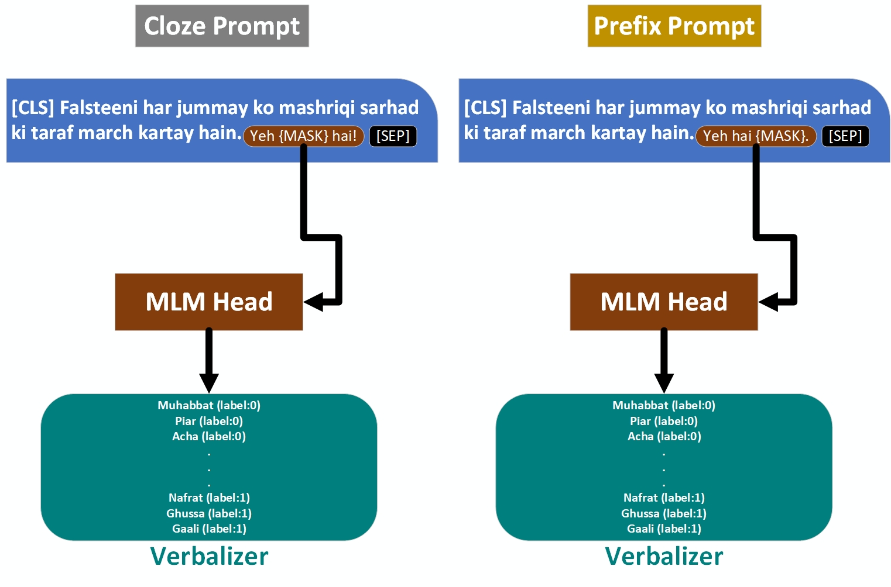

### 3. Prompt engineering (GPT-3.5)

The zero-shot prompt gives only task instructions. The few-shot prompt adds curated labelled examples as user/assistant message pairs before the comment to classify.

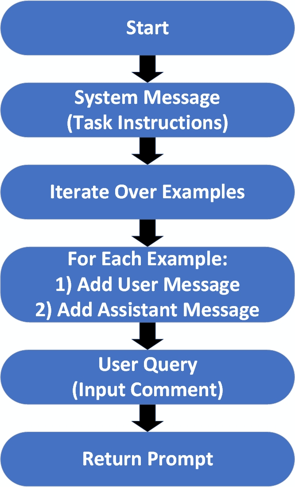

## Results

Macro scores treat both classes equally, which matters here because only about 18% of comments are toxic.

### QLoRA fine-tuning

Test set: last 20% of the data (14,555 comments). 4-bit NF4 quantisation, LoRA r=16, alpha=8, 2 epochs, class-weighted loss. Trained on an NVIDIA A100 GPU.

| Model | Accuracy | Macro precision | Macro recall | Macro F1 | Training time |
|---|---|---|---|---|---|
| Mistral-7B-v0.3 | 96.4% | 93.8% | 93.9% | **93.9%** | 7h 23m |
| Llama-3-8B | 96.4% | 94.1% | 93.5% | 93.8% | 6h 58m |
| Falcon-7B | 95.3% | 92.5% | 91.1% | 91.8% | 6h 39m |
| Gemma-2B | 94.6% | 90.5% | 91.3% | 90.9% | 2h 01m |
| mBERT (uncased) | 89.4% | 81.8% | 82.2% | 82.0% | 0h 25m |
| DeepSeek-R1-Distill-Qwen-7B | 83.5% | 72.8% | 77.7% | 74.7% | 4h 21m |

Before fine-tuning, most models labelled almost every comment as toxic (macro F1 0.15–0.56). Fine-tuning lifted every model above 0.74.

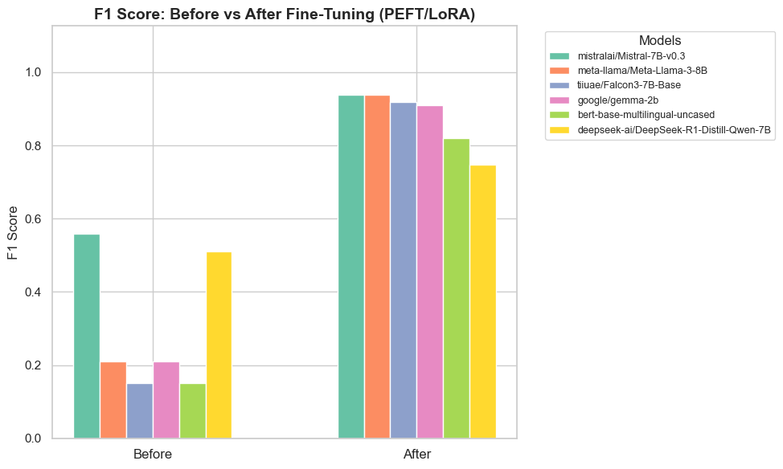

<details>
<summary>More fine-tuning charts</summary>

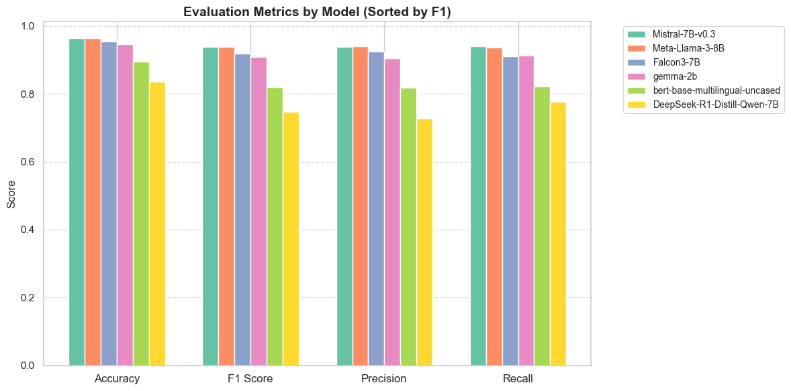
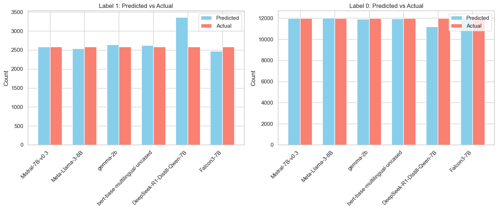
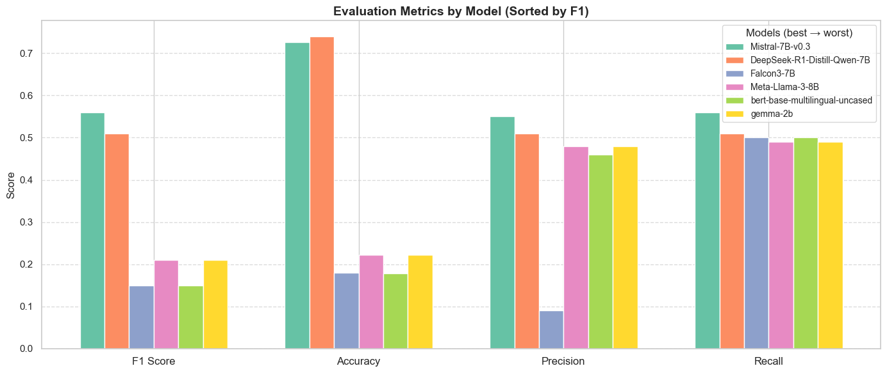
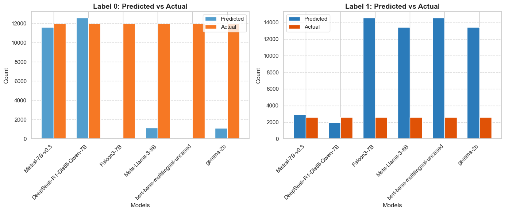

</details>

### Prompt engineering (GPT-3.5 on Azure OpenAI)

Evaluated over the full dataset at temperature 0.

| Prompt | Accuracy | Macro precision | Macro recall | Macro F1 |
|---|---|---|---|---|
| Few-shot (curated examples) | 91.0% | 82.8% | 89.9% | **85.7%** |
| Zero-shot | 72.3% | 68.0% | 81.3% | 67.0% |

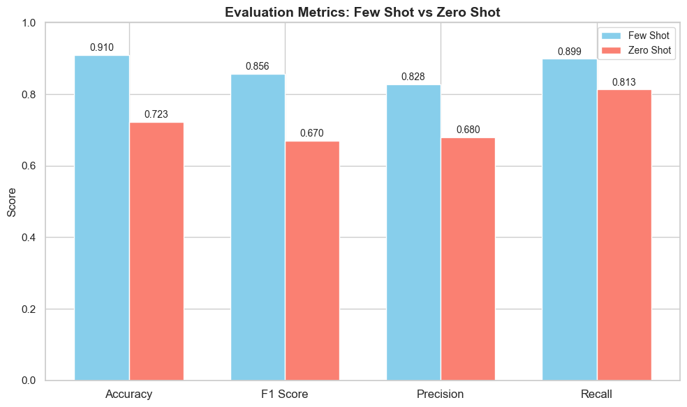

### Prompt tuning (mBERT, OpenPrompt)

K labelled examples per class (K = 32, 64, 128), 3 epochs, 2 random rounds per K, tested on all remaining examples. Best run shown.

| Method | Template | Best K | Accuracy | Macro F1 |
|---|---|---|---|---|
| Mixed prompt | `<comment> [soft: Yeh] [soft: comment hai] [MASK]` | 128 | 75.0% | **68.5%** |
| Prefix prompt | `<comment> Ye hai [MASK]!` | 128 | 80.5% | 68.1% |
| Cloze prompt | `<comment> Ye[MASK] hai!` | 128 | 68.4% | 61.7% |

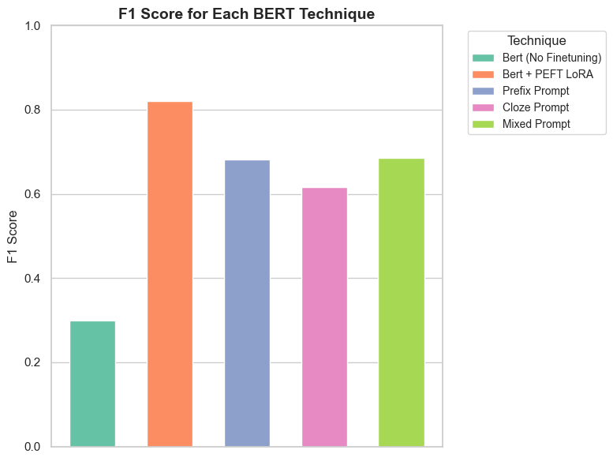

<details>
<summary>Metrics by K for each prompt</summary>

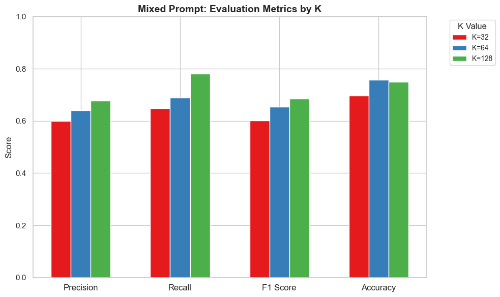
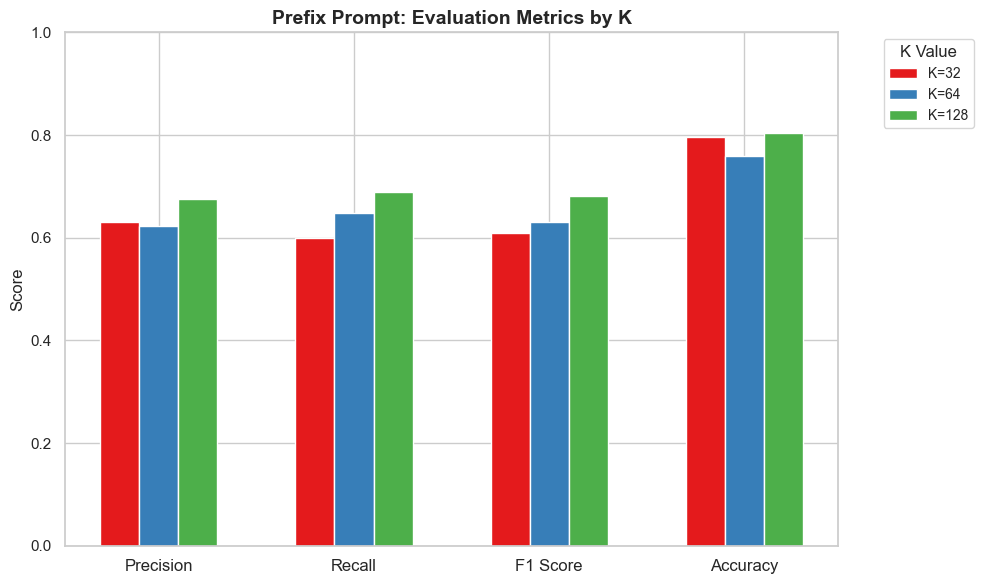
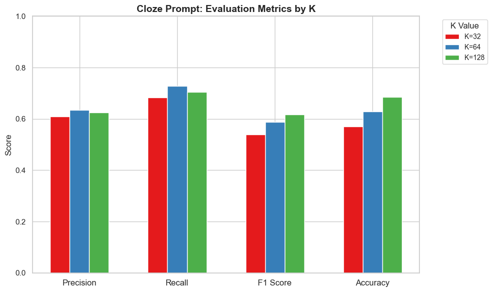

</details>

All figures are in [`results/metrics.csv`](results/metrics.csv). The three approaches were evaluated on different test sets, so compare across approaches with care.

## Repository structure

```
├── notebooks/
│   ├── 1_fine_tuning/          # QLoRA fine-tuning of 6 models
│   ├── 2_prompt_tuning/        # Mixed, prefix and cloze prompt tuning (OpenPrompt)
│   └── 3_prompt_engineering/   # Zero-shot and few-shot prompting (Azure OpenAI)
├── results/
│   ├── metrics.csv
│   └── figures/                # Result charts
├── docs/diagrams/              # Method diagrams
├── data/                       # Dataset goes here (not included)
├── requirements.txt
└── .env.example
```

## How to run

```bash
git clone https://github.com/ToneemaDS/roman-urdu-hate-speech-llm.git
cd roman-urdu-hate-speech-llm
pip install -r requirements.txt
cp .env.example .env   # add your Hugging Face token and Azure OpenAI details
```

1. Put the dataset in `data/` (see [`data/README.md`](data/README.md)).
2. Open any notebook in `notebooks/` and run it top to bottom. Models and checkpoints are saved to `outputs/`.
3. The fine-tuning notebooks need a CUDA GPU with at least 16 GB of memory (the experiments used an NVIDIA A100). Llama 3 and Gemma are gated models, so accept their licences on Hugging Face first.

## Tech stack

Python · PyTorch · Hugging Face Transformers · PEFT (LoRA / QLoRA) · bitsandbytes · Datasets · OpenPrompt · Azure OpenAI · scikit-learn · pandas

## Publications

- T. Zubair, M. J. Asif, F. Kamiran, H. H. Saeed and R. F. Ahmad, "Efficient Adaptation of LLMs for Hate Speech Detection in Low-Resource Languages: A Comparative Study on Roman Urdu," *IBCAST 2026*, pp. 57–62. [doi:10.1109/IBCAST71075.2026.11761662](https://doi.org/10.1109/IBCAST71075.2026.11761662) · [arXiv:2608.18142](https://arxiv.org/abs/2608.18142)
- T. Zubair et al., "Beyond Fine-Tuning: Evaluating Prompt Engineering and Prompt Tuning for Roman Urdu Hate Speech Detection," [arXiv:2611.04342](https://arxiv.org/abs/2611.04342), 2026.
- T. Zubair, "Hate Speech Classification in Roman Urdu: A Comparative Study on Parameter Efficient Fine-Tuning and Prompt Engineering," M.S. thesis, ITU, 2025. [arXiv:2608.21408](https://arxiv.org/abs/2608.21408)

If you use this work, please cite the IBCAST paper.

## Author

**Toneema Zubair**, AI Engineer · [LinkedIn](https://www.linkedin.com/in/toneema-zubair-13937b255)

## Acknowledgements

The Roman Urdu dataset was provided by Dr. Hafiz Hassaan Saeed and is not publicly available, so it is not included in this repository.

> **Content warning:** this project deals with hate speech. The dataset and some notebook cells contain offensive language.

## License

[MIT](LICENSE)
